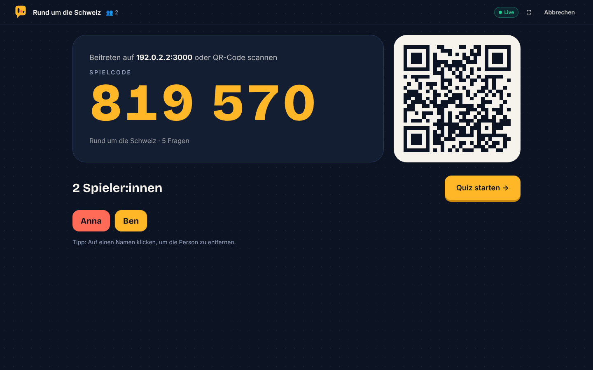
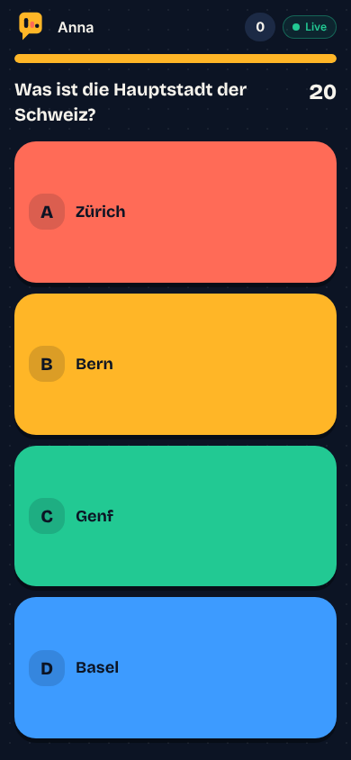
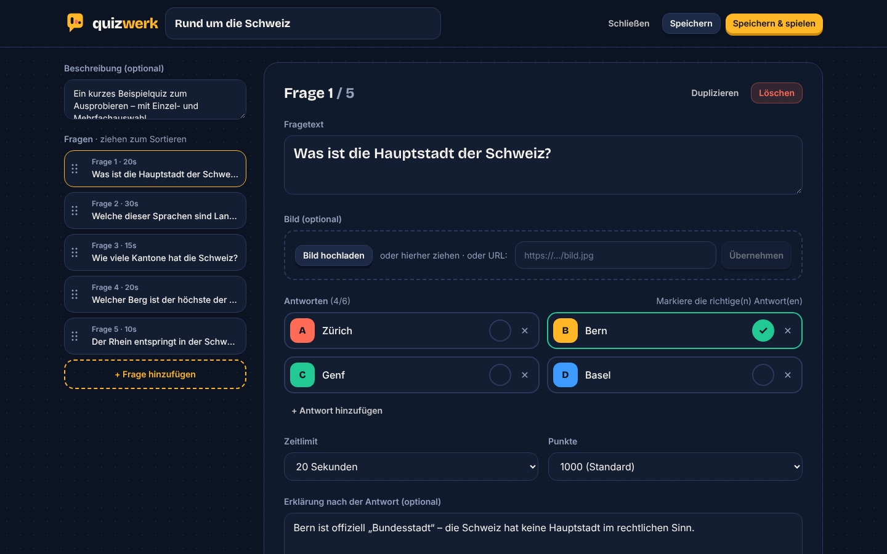
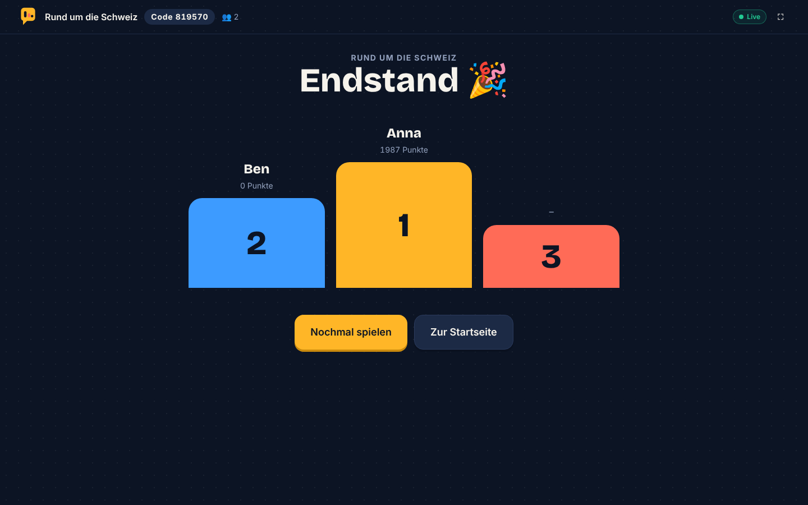

# Quizwerk 🟡 Live-Multiplayer-Quiz

Quizwerk ist eine moderne Web-App, mit der du Quizze **erstellst oder importierst** und sie anschließend **live mit
beliebig vielen Geräten** spielst. Der Host zeigt Fragen auf einem großen Bildschirm, alle anderen treten per
**sechsstelligem Spielcode oder QR-Code** mit Smartphone, Tablet oder Laptop bei – ganz ohne App-Installation.

> Quizwerk ist ein eigenständiges Projekt mit eigenem Design und eigener Implementierung. Es verwendet keine Logos,
> Marken oder Designs anderer Quiz-Plattformen und lädt keine Inhalte per Scraping.

| Host-Lobby mit QR-Code | Spieler-Ansicht | Editor | Podium |
|---|---|---|---|
|  |  |  |  |

---

## Inhalt

- [Funktionen](#funktionen)
- [Schnellstart (ohne Konto, 2 Minuten)](#schnellstart-ohne-konto-2-minuten)
- [Im WLAN mit Smartphones spielen](#im-wlan-mit-smartphones-spielen)
- [Mit Supabase betreiben](#mit-supabase-betreiben)
- [Spielablauf](#spielablauf)
- [Quiz-Import & Dateiformat](#quiz-import--dateiformat)
- [Architektur](#architektur)
- [Projektstruktur](#projektstruktur)
- [Erweitern](#erweitern)
- [Skripte](#skripte)
- [Fehlerbehebung](#fehlerbehebung)
- [Sicherheit & Grenzen](#sicherheit--grenzen)

---

## Funktionen

**Beitrittsseite (`/`)**
- Nur ein Eingabefeld für den Spielcode – ideal für Spieler:innen
- Kurzlink `/<CODE>` (z. B. `/123456`) führt direkt ins Spiel; der QR-Code nutzt ihn

**Admin-Bereich (`/admin`)**
- Geschützt mit `ADMIN_PASSWORD` (ohne Variable offen, z. B. lokal)
- Übersicht aller gespeicherten Quizze mit *Hosten*, *Bearbeiten*, *Export (JSON)* und *Löschen*
- „Quiz erstellen“, „Importieren“ und „Beispielquiz anlegen“ für den ersten Test

**Quiz-Editor**
- Fragetext, optionales Bild (Upload mit automatischer Verkleinerung, Drag & Drop oder Bild-URL)
- 2 bis 6 Antwortmöglichkeiten, **eine oder mehrere richtige Antworten** (mehrere = Mehrfachauswahl)
- Zeitlimit (5 s – 4 min) und Punkte (0 / 500 / 1000 / 2000) pro Frage
- Optionale Erklärung, die nach der Auflösung auf allen Geräten erscheint
- Fragen per **Drag & Drop sortierbar** (Maus, Touch und Tastatur), duplizieren, löschen
- Live-Validierung mit verständlichen Fehlermeldungen, Warnung bei ungespeicherten Änderungen
- „Speichern & spielen“ startet direkt ein Live-Spiel

**Import**
- **JSON** (einfaches Format und dokumentiertes Quizwerk-Format, auch mehrere Quizze pro Datei)
- **CSV** (Excel/Numbers/Google Sheets, `;` `,` oder Tab, deutsche oder englische Spaltennamen)
- Text direkt einfügen (Format wird automatisch erkannt)
- **Offizielle Datenquellen** – als Beispiel die frei nutzbare *Open Trivia Database* (CC BY-SA 4.0)
- **Andere Plattform**: Link einfügen → Quizwerk erkennt bekannte Plattformen ohne offizielle Import-API und erklärt
  klar den manuellen Weg über JSON/CSV
- Vorschau mit Fehlern und Hinweisen, Titel anpassen, „Im Editor öffnen“ zum Korrigieren
- Downloadbare Vorlagen und Format-Dokumentation unter `/admin/format`

**Live-Spiel**
- Lobby mit großem Code, **QR-Code** und Spielerliste (Spieler per Klick entfernen)
- Automatische Erkennung der Netzwerk-IP, damit der QR-Code auch funktioniert, wenn der Host über `localhost` läuft
- Lesezeit vor jeder Frage (4–8 s je nach Textlänge): erst die Frage, dann die Antworten
- Synchroner Countdown auf allen Geräten (unabhängig von abweichenden Geräteuhren)
- Punkte nach Geschwindigkeit (100 % sofort → 50 % kurz vor Ablauf), Serien-Anzeige 🔥
- Auflösung mit Antwortverteilung, Erklärung, Rangliste nach jeder Frage, Podium am Ende
- Spieler sehen „Richtig/Falsch“, gewonnene Punkte, Platzierung und die richtige Lösung
- **Robust**: Neu laden auf Host oder Spieler-Gerät stellt den Spielstand wieder her, Antworten werden bis zur
  Bestätigung erneut gesendet, doppelte Namen werden abgelehnt, Verbindungsstatus wird angezeigt
- Endergebnisse (Spieler, Punkte, Ränge) werden in der Datenbank gespeichert

---

## Schnellstart (ohne Konto, 2 Minuten)

Voraussetzung: **Node.js ≥ 20.9** (empfohlen 22 LTS) und npm.

```bash
# 1. Abhängigkeiten installieren
npm install

# 2. Entwicklungsserver + lokalen Live-Relay starten
npm run dev
```

Öffne **http://localhost:3000/admin**, klicke auf **„Beispielquiz anlegen“** und dann auf **„▶ Hosten“**.
Öffne die angezeigte Beitritts-Adresse in einem zweiten Browserfenster (oder auf dem Handy), gib einen Namen ein –
fertig.

Ohne weitere Konfiguration nutzt Quizwerk:

| Baustein | Lokaler Modus (Standard) | Supabase-Modus |
|---|---|---|
| Quizze, Spielräume, Ergebnisse | JSON-Datei `.data/db.json` | Postgres-Tabellen |
| Live-Verbindung | WebSocket-Relay `relay/server.mjs` (Port 3001) | Supabase Realtime Broadcast |

`npm run dev` startet Next.js (Port 3000) **und** den Relay (Port 3001) gemeinsam.

---

## Im WLAN mit Smartphones spielen

1. Rechner und Smartphones müssen **im selben Netzwerk** sein.
2. `npm run dev` (oder für mehr Leistung `npm run build && npm start`).
3. Öffne den Host wie gewohnt über `http://localhost:3000`. Die Lobby ermittelt automatisch die Netzwerk-IP deines
   Rechners und erzeugt damit QR-Code und Adresse (z. B. `192.168.1.20:3000`).
4. Smartphones scannen den QR-Code oder öffnen die Adresse und geben den Code ein.

Falls es nicht klappt:
- **Firewall**: Ports **3000** und **3001** für eingehende Verbindungen im privaten Netz erlauben
  (macOS fragt beim ersten Start nach, Windows Defender ebenfalls).
- Mehrere Netzwerkkarten/VPN? Setze die richtige Adresse fest:
  `PUBLIC_BASE_URL=http://192.168.1.20:3000` in `.env.local`.
- Gäste-/Firmen-WLANs blockieren oft Verbindungen zwischen Geräten („Client Isolation“). Dann einen eigenen
  Hotspot nutzen oder Supabase verwenden (siehe unten) und die App deployen.
- Der Dev-Server erlaubt typische private Netze (`192.168.*.*`, `10.*.*.*`, `172.*.*.*`, `*.local`). Weitere
  Hostnamen (z. B. Tunnel) über `ALLOWED_DEV_ORIGINS` ergänzen.

---

## Mit Supabase betreiben

Mit Supabase liegen die Daten in Postgres und die Live-Verbindung läuft über **Supabase Realtime** – ideal, wenn die
App im Internet erreichbar sein soll (z. B. auf Vercel).

1. Kostenloses Projekt auf [supabase.com](https://supabase.com) anlegen.
2. Im Dashboard **SQL Editor** öffnen, den Inhalt von [`supabase/schema.sql`](supabase/schema.sql) einfügen und
   ausführen. Es entstehen die Tabellen `quizzes`, `games` und `players`.
3. `.env.example` nach `.env.local` kopieren und ausfüllen
   (Dashboard → *Project Settings* → *API*):

   ```env
   SUPABASE_URL=https://xxxx.supabase.co
   SUPABASE_ANON_KEY=eyJ...
   SUPABASE_SERVICE_ROLE_KEY=eyJ...   # bleibt serverseitig, nie im Browser
   ```

4. `npm run dev` neu starten. Unter `http://localhost:3000/api/health` siehst du
   `"storage":"supabase","realtime":"supabase"`.

Hinweise:
- Die Supabase-Werte werden **zur Laufzeit** gelesen und nicht in den Build eingebaut: Der Server liest sie direkt,
  der Browser holt URL und Anon-Key über `/api/config`. Auf Cloudflare gehören sie deshalb als *Secrets* in den Worker.
- Für Realtime werden **keine** Tabellen benötigt – Quizwerk nutzt *Broadcast*-Kanäle `quizwerk:<CODE>`. Falls du in
  den Realtime-Einstellungen „Nur private Kanäle erlauben“ aktiviert hast, deaktiviere das oder ergänze
  entsprechende RLS-Policies für `realtime.messages`.
- Ohne Service-Role-Key kannst du die auskommentierten Demo-Policies im Schema aktivieren (nur für Tests!).
- Der lokale Relay startet mit `npm run dev` weiterhin, wird im Supabase-Modus aber nicht verwendet. Für reinen
  Next.js-Betrieb gibt es `npm run dev:next` bzw. `npm run start:next`.

**Deployment (z. B. Vercel):** Repository importieren, die drei Supabase-Variablen setzen, deployen. Im
Supabase-Modus wird der Relay nicht benötigt.

---

## Spielablauf

```
Host: Quiz wählen → „Live spielen“ → Lobby (Code + QR)
Spieler: Code eingeben / QR scannen → Name → wartet in der Lobby
Host: „Quiz starten“
  ┌─► Frage läuft (Countdown) ── Spieler antworten auf ihrem Gerät
  │   Zeit abgelaufen / alle haben geantwortet / „Überspringen“
  │   Auflösung: richtige Antwort, Verteilung, Erklärung · Spieler sehen Ergebnis + Punkte
  │   „Weiter“ → Rangliste → „Nächste Frage“ ─┐
  └────────────────────────────────────────────┘
Letzte Frage → „Endergebnis“ → Podium · Ergebnisse werden gespeichert
```

**Punkte:** `Punkte × (1 − 0,5 × benötigte Zeit / Zeitlimit)`, nur bei vollständig richtiger Antwort. Bei
Mehrfachauswahl müssen **genau** die richtigen Optionen gewählt sein.

---

## Quiz-Import & Dateiformat

Die vollständige Spezifikation steht in **[`docs/FORMAT.md`](docs/FORMAT.md)** und in der App unter `/admin/format`.
Beispieldateien: [`examples/beispiel-quiz.json`](examples/beispiel-quiz.json), [`examples/beispiel-quiz.csv`](examples/beispiel-quiz.csv).

**JSON (Kurzform)**

```json
{
  "title": "Mein Quiz",
  "questions": [
    {
      "question": "Was ist die Hauptstadt der Schweiz?",
      "answers": [
        { "text": "Zürich", "correct": false },
        { "text": "Bern", "correct": true },
        { "text": "Genf", "correct": false },
        { "text": "Basel", "correct": false }
      ],
      "timeLimit": 20,
      "points": 1000
    }
  ]
}
```

Optional pro Frage: `image`, `explanation`. Optional oben: `"format": "quizwerk", "version": 1`, `description`, oder
`"quizzes": [...]` für mehrere Quizze. Export aus der App erzeugt genau dieses Format.

**CSV (Kurzform)**

```csv
titel;frage;antwort1;antwort2;antwort3;antwort4;richtig;zeit;punkte;erklaerung
Mein Quiz;Was ist die Hauptstadt der Schweiz?;Zürich;Bern;Genf;Basel;2;20;1000;Bern ist die Bundesstadt.
;Welche Zahlen sind Primzahlen?;2;9;11;15;1|3;30;2000;
```

**Externe Plattformen:** Quizwerk umgeht keine Schnittstellen und betreibt kein Scraping. Für Plattformen ohne
offizielle Import-API zeigt der Tab „Andere Plattform“ eine klare Meldung und die Schritte für den manuellen Import
über JSON/CSV.

---

## Architektur

```
┌────────────── Host-Browser ──────────────┐          ┌──── Spieler-Browser (n×) ────┐
│ useHostGame                               │ Snapshot │ usePlayerGame                │
│  ├─ engine.ts  (reine Spiellogik,         │ ───────► │  ├─ rendert Phase            │
│  │   Punkte, Rangliste, Snapshot)         │          │  ├─ lokaler Countdown        │
│  └─ RealtimeChannel ◄─────────────────────┼──────────┼─ join / answer / hello       │
└───────────────┬──────────────────────────┘ Nachr.    └──────────────────────────────┘
                │ REST (Quiz laden, Status, Ergebnisse)
        ┌───────▼────────┐      Realtime: Supabase Broadcast  ODER  relay/server.mjs
        │ Next.js API    │
        │ Repository ────┼──► Supabase Postgres  ODER  .data/db.json
        └────────────────┘
```

- **Host-autoritativ:** Nur der Host kennt die richtigen Antworten. Spieler erhalten während einer Frage einen
  Snapshot **ohne Lösung**; Punkte werden ausschließlich beim Host berechnet.
- **Snapshots statt Event-Strom:** Der Host sendet bei jeder Änderung (gebündelt) und alle 3 s als Heartbeat den
  vollständigen öffentlichen Zustand. Spät beitretende oder neu ladende Geräte sind so sofort synchron.
- **Zeit:** Der Snapshot enthält die *Restzeit* statt eines Zeitstempels – abweichende Geräteuhren spielen keine Rolle.
  Antworten werden mit der Empfangszeit beim Host bewertet (+800 ms Kulanz für Netzwerklatenz).
- **Wiederherstellung:** Der Host speichert seinen Zustand in `sessionStorage`, Spieler ihre ID in `localStorage`.
- **Austauschbare Bausteine:** `Repository` (Speicher) und `RealtimeChannel` (Transport) sind Interfaces mit je zwei
  Implementierungen.

---

## Projektstruktur

```
app/
  page.tsx                 Beitrittsseite (nur Spielcode)
  [code]/                  Kurzlink /123456 → /play/123456
  play/[code]/             Spieler-Ansicht
  admin/login/             Admin-Anmeldung
  admin/(app)/             geschützt (layout.tsx prüft die Anmeldung)
    page.tsx               Quiz-Übersicht
    create/, edit/[id]/    Quiz-Editor
    import/, format/       Import-Assistent, Format-Dokumentation
    host/[code]/           Host-Bildschirm
  api/
    quizzes/               GET, POST · [id]: GET, PUT, DELETE
    games/                 POST (Spielraum + Code) · [code]: GET, PATCH · [code]/results: GET, POST
    network/               LAN-Adressen für den QR-Code
    health/                aktiver Speicher-/Realtime-Modus
    admin/login, logout    Admin-Sitzung (Cookie)
components/
  ui/                      Button, Logo, Timer, Verbindungsstatus, Antwortfarben
  admin/  home/  editor/  import/  host/  player/
lib/
  types.ts, schema.ts      Datenmodell + Zod-Validierung
  storage/                 Repository-Interface, Supabase- und Datei-Implementierung
  realtime/                RealtimeChannel-Interface, Supabase- und WebSocket-Implementierung
  game/                    protocol.ts, engine.ts (rein), useHostGame, usePlayerGame
  import/                  Import-Schnittstelle, Registry, Importer (JSON, CSV), Quellen (OpenTDB, Plattform-Hinweise)
relay/server.mjs           Minimaler WebSocket-Relay für den lokalen Betrieb
supabase/schema.sql        Datenbankschema
docs/FORMAT.md             Spezifikation des Quizformats
tests/                     Unit-Tests für Spiel-Logik und Import
```

---

## Erweitern

### Neues Dateiformat

```ts
// lib/import/importers/mein-format.ts
import type { QuizImporter } from "../types";
import { normalizeQuiz } from "../normalize";

export const meinImporter: QuizImporter = {
  id: "mein-format",
  label: "Mein Format",
  description: "…",
  extensions: [".mein"],
  parse({ content, fileName }) {
    const raw = /* content parsen */ {};
    return { source: "Mein Format", quizzes: [normalizeQuiz(raw, fileName ?? "Quiz")] };
  },
};
```

Danach in `lib/import/registry.ts` zu `fileImporters` hinzufügen – Dateiauswahl, Drag & Drop, Vorschau und
Validierung funktionieren automatisch.

### Offizielle API / erlaubte Datenquelle

Implementiere `RemoteSource` (siehe `lib/import/sources/opentdb.ts`): Optionen beschreiben (Zahl/Auswahl, Auswahl auch
dynamisch ladbar), `fetchQuiz()` liefert ein `ImportResult`, `license` wird angezeigt. In `remoteSources` eintragen –
das Formular im Tab „Offizielle Quellen“ entsteht automatisch.

Braucht die API einen geheimen Schlüssel oder OAuth (z. B. Google Forms API), lege eine Route unter
`app/api/import/<quelle>/route.ts` an, die serverseitig abfragt, und rufe sie in `fetchQuiz()` auf. So bleibt der
Schlüssel auf dem Server. Bietet eine Plattform aus `lib/import/sources/platforms.ts` später eine offizielle API an,
ersetze den Hinweis-Eintrag durch eine solche Quelle.

### Anderes Backend / anderer Transport

- Speicher: `Repository` aus `lib/storage/types.ts` implementieren und in `lib/storage/index.ts` auswählen.
- Live-Verbindung: `RealtimeChannel` aus `lib/realtime/types.ts` implementieren (z. B. Pusher, Ably, Socket.IO) und in
  `lib/realtime/index.ts` auswählen.

---

## Skripte

| Befehl | Zweck |
|---|---|
| `npm run dev` | Next.js-Dev-Server (alle Netzwerkadressen) + Relay |
| `npm run build` | Produktions-Build |
| `npm start` | Produktionsserver + Relay |
| `npm run dev:next` / `npm run start:next` | nur Next.js (z. B. im Supabase-Modus) |
| `npm run relay` | nur den Relay starten |
| `npm test` | Unit-Tests (Spiellogik, Punkte, Import) |
| `npm run typecheck` | TypeScript-Prüfung |

---

## Fehlerbehebung

| Problem | Lösung |
|---|---|
| Badge zeigt „Getrennt – verbinde neu“ | Läuft der Relay? `npm run dev` startet ihn mit. Port 3001 frei? Firewall? |
| Handy findet die Seite nicht | Gleiches WLAN? Firewall für Port 3000/3001? `PUBLIC_BASE_URL` setzen. |
| „Spiel nicht gefunden“ | Code prüfen. Im lokalen Modus muss derselbe Server laufen, der das Spiel erstellt hat. |
| Host-Tab geschlossen | Seite `/admin/host/<CODE>` im selben Tab neu öffnen bzw. neu laden – der Zustand wird wiederhergestellt. |
| Open Trivia DB: „Zu viele Anfragen“ | Die API erlaubt eine Anfrage alle 5 Sekunden – kurz warten. |
| Supabase: keine Live-Updates | Realtime im Projekt aktiv? „Private channels only“ deaktiviert? Keys korrekt? |
| Große Bilder | Uploads werden auf 1024 px verkleinert. Sehr große data-URLs werden nur auf dem Host-Bildschirm gezeigt. |

---

## Sicherheit & Grenzen

- Quizwerk hat bewusst **keine Benutzerkonten** – jeder mit Zugriff auf die App kann Quizze sehen und bearbeiten.
  Für öffentliche Deployments Supabase Auth ergänzen und RLS-Policies auf den Besitzer einschränken.
- Die Lösungen verlassen den Host-Browser erst bei der Auflösung. Die REST-Route `/api/quizzes/[id]` liefert das
  komplette Quiz aber an jeden, der die ID kennt – mit Authentifizierung absichern, wenn das wichtig ist.
- Spielnamen werden auf 20 Zeichen begrenzt und als Text gerendert (kein HTML).
- Der lokale Relay ist für vertrauenswürdige Netze gedacht und prüft keine Absender.

Inhalte der Open Trivia Database stehen unter CC BY-SA 4.0; die Attribution wird automatisch in die Quizbeschreibung
übernommen.
